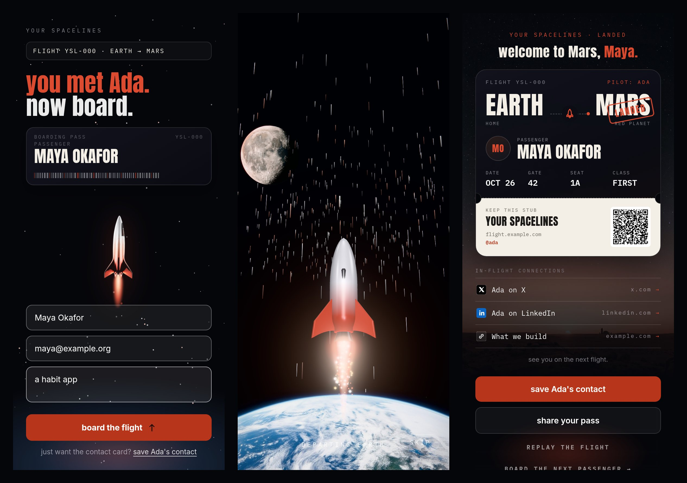

# flight-pass

A contact swap for events that people want to finish. A guest scans your QR code, types their name and email, and rides a rocket from Earth past the Moon, round the Sun and down onto Mars. They land on a boarding pass with your links and your contact card, and you get their details.



We built this for our own conference trips at [Agniverse](https://agniverse.co). The live one is [fly.agniverse.co](https://fly.agniverse.co). This repo is the same engine with our brand, our people and our backend taken out, so you can fork it and fly your own.

## What you get

- **The boarding screen.** Name, email and an optional "what are you building?". The ticket stub fills in as they type.
- **A 10 second WebGL flight.** three.js, loaded only after the form is on screen and built while the guest types, so pressing board plays at once. It falls back to a 2D canvas flight on devices without WebGL2, and goes straight to the pass for people with reduced motion turned on.
- **Three vehicles, or your own.** A rocket, a galloping horse and a solid-gold gorilla. Set `vehicle: "custom"` to fly any `.glb` model.
- **The boarding pass.** Their name, a QR code of the pass link, your links, a "save contact" button that downloads a vCard, a "share your pass" button that renders a 1080x1350 PNG, and a replay.
- **Pass links with no database.** `/p/<token>` carries the name, host, event and date in the URL itself (never the email), so every pass link works even if you store nothing.
- **Lead adapters you switch on with env vars.** Webhook, Supabase, Customer.io and Resend. Any mix, or none.
- **Spam basics.** A 5 per minute per IP limit. No hidden honeypot field: browsers autofill hidden fields, and a fake success would silently drop a real guest's lead.

## Quick start

```bash
git clone https://github.com/Git-Agni/flight-pass.git
cd flight-pass
npm install
npm run dev
```

Open http://localhost:3000 and board. With no env vars set, the flight and pass work and each boarding is logged to your terminal.

## Make it yours

Everything lives in [`flight.config.ts`](flight.config.ts).

**Hosts** are the people a guest can meet. Each key becomes a route, so `ada` lives at `/ada` and gets its own QR code. `defaultHost` is who `/` boards with. Each host has a display name, a pilot name for the pass, a vehicle, a contact card and a row of links.

**Events** set the flight number and the origin printed on the pass ("SFO, SAN FRANCISCO"). The event whose date window contains today is picked automatically. Outside every window, `evergreen` is used. Add `?e=<tag>` to any URL to force an event while testing.

**Pass and copy** cover the destination, the gate, seat and class easter eggs, and the few lines of text around the form and pass. `copy.closing` sits under the pass, so only promise an email there if you send one.

**Thesis lines** are optional big type that appears over the flight, timed by `at` (0 to 1 through the flight). Wrap a word in `*stars*` to set it in the accent colour.

**Colours** are CSS variables at the top of [`app/flight.css`](app/flight.css) (`--verm`, `--ember`). The 3D engine colours are in [`components/journey3d.ts`](components/journey3d.ts).

Print each host's URL as a QR code on a card, a badge or a phone wallpaper. Keep those URLs stable once printed.

### Fly your own model

```ts
// flight.config.ts
customVehicle: {
  model: "/flight/my-model.glb", // in /public
  rotationY: 0,                  // degrees, if it doesn't face +Z
  uprightRoll: 90,               // degrees, which side faces the camera on the pad
  padImage: "/flight/my-model.png", // transparent sprite for the launch pad
  engine: { core: "#fff4ec", edge: "#DC4A2F" },
},
```

Then set `vehicle: "custom"` on a host. The model is scaled to the rocket's length and flown on the same path. Its first animation clip plays if it has one. Keep it under about 1 MB: [gltf.report](https://gltf.report) and [meshoptimizer](https://github.com/zeux/meshoptimizer) will shrink most models. If it fails to load, the rocket flies instead.

## Where the leads go

Set any of these in `.env.local` (copy [`.env.example`](.env.example)) or in your host's environment settings. Every adapter you configure gets every lead. They run after the response is sent, so a slow service never holds up the flight, and one failing never stops the others.

| Adapter | Env vars | What it does |
| --- | --- | --- |
| Webhook | `LEAD_WEBHOOK_URL`, `LEAD_WEBHOOK_SECRET` | POSTs `{ type: "flight.boarded", lead }`. With a secret, signs the body as `x-flight-pass-signature: sha256=<hmac>`. Works with Zapier, Make, n8n or your own API. |
| Supabase | `SUPABASE_URL`, `SUPABASE_SERVICE_ROLE_KEY` | Upserts into `flight_leads` on (email, event). Run [`supabase/schema.sql`](supabase/schema.sql) first. |
| Customer.io | `CUSTOMERIO_SITE_ID`, `CUSTOMERIO_API_KEY`, `CUSTOMERIO_REGION` | Identifies the guest and tracks `flight_boarded`, ready to trigger a follow-up campaign. Set the region to `eu` for EU workspaces. |
| Resend | `RESEND_API_KEY`, `RESEND_FROM`, `RESEND_NOTIFY_TO`, `RESEND_SEND_CONFIRMATION` | Emails you a "new passenger" note. With `RESEND_SEND_CONFIRMATION=true` it also sends the guest their pass link. |

A lead looks like this:

```json
{
  "id": "778b19c6-...",
  "name": "Maya Okafor",
  "email": "maya@example.org",
  "building": "a habit app",
  "host": "ada",
  "hostName": "Ada Lovelace",
  "event": "launch-week-2026",
  "passUrl": "https://your-site/p/eyJuIjoi...",
  "userAgent": "...",
  "boardedAt": "2026-11-03T16:20:11.000Z"
}
```

To send leads somewhere else, write a `LeadAdapter` in [`lib/leads`](lib/leads) and add it to the list in `lib/leads/index.ts`.

For a rate limit shared across server instances, set `UPSTASH_REDIS_REST_URL` and `UPSTASH_REDIS_REST_TOKEN`. Without them, each instance counts in memory.

Analytics events (`flight_scan_landed`, `flight_boarding_submitted`, `flight_pass_viewed`, `flight_vcard_downloaded`, `flight_pass_shared`) go to PostHog if its snippet is on the page. They also fire as a `flight-pass` DOM event, so you can hook up anything else.

## Deploy

[](https://vercel.com/new/clone?repository-url=https%3A%2F%2Fgithub.com%2FGit-Agni%2Fflight-pass)

It is a plain Next.js 15 app with no database required, so any Node host works. Point a subdomain at it (we use `fly.`), set `siteLabel` in the config to match, and print your QR codes.

## How the flight works

[`components/journey3d.ts`](components/journey3d.ts) is one self-contained three.js scene driven by a single 0 to 1 clock. Speed, heading and camera are monotone cubic tracks, so nothing jerks at a keyframe. The rocket's path is integrated once up front, and the Moon, Sun and Mars are placed where the rocket will actually be at each beat. The camera rides a critically damped spring. Bloom only catches the sun and the engine, so everything else stays sharp. If a phone can't hold about 50 fps in the first second, it drops the pixel ratio once while the warp hides it.

[`components/FlightExperience.tsx`](components/FlightExperience.tsx) runs the boarding screen, the 2D fallback, the sound (synthesised, no audio files) and the pass.

## Credits

- Gold gorilla: "Gorilla" by [Digga79](https://www.thingiverse.com/thing:4733596), CC BY 4.0, simplified to 24k triangles. Keep the credit line on the pass if you fly it (it shows automatically).
- Horse: from the [three.js examples](https://github.com/mrdoob/three.js/tree/dev/examples/models/gltf), MIT.
- Planet and rocket images: made for Agniverse, released here under MIT with the code.
- Fonts: Anton, IBM Plex Mono and Inter from Google Fonts.

The "made with flight-pass by Agniverse" line under the pass is on by default. Turn it off with `credit: false`. We'd love to see what you fly, so tag [@consumerxai](https://x.com/consumerxai) if you ship one.

## License

MIT. See [LICENSE](LICENSE).
